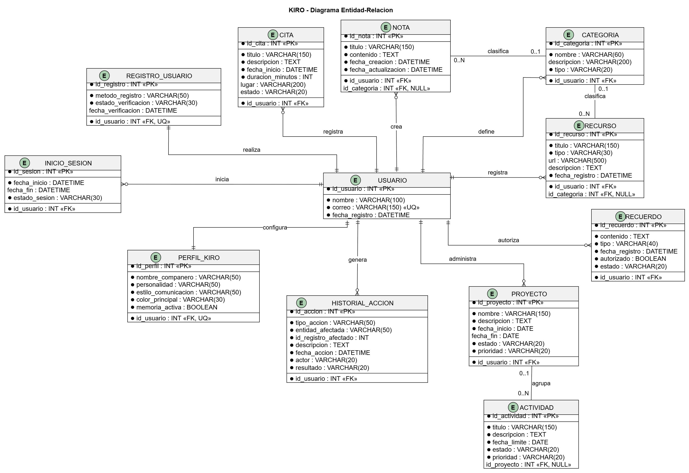

# KIRO

> «Tu mundo organizado, con un compañero a tu lado».

**KIRO** es una aplicación web que funciona como compañero digital interactivo y colaborativo: un personaje con identidad visual y personalidad propia que comparte con el usuario un entorno de información, lo acompaña en sus actividades personales y participa en la organización de sus proyectos y tareas.

> **Documento conceptual y de planificación.** Este README describe la propuesta, el alcance previsto, la arquitectura inicial y los objetivos académicos del proyecto. No constituye evidencia de funcionalidades implementadas.

---

## Índice

- [1. Presentación](#1-presentación)
- [2. El problema](#2-el-problema)
- [3. Objetivo general](#3-objetivo-general)
- [4. Los tres pilares de KIRO](#4-los-tres-pilares-de-kiro)
- [5. Módulos funcionales](#5-módulos-funcionales)
- [6. Características diferenciadoras](#6-características-diferenciadoras)
- [7. Apariencia y personalidad](#7-apariencia-y-personalidad)
- [8. Enfoque académico: Bases de Datos II](#8-enfoque-académico-bases-de-datos-ii)
- [9. Diseño de la base de datos](#9-diseño-de-la-base-de-datos)
- [10. Tecnologías propuestas](#10-tecnologías-propuestas)
- [11. Arquitectura del sistema y despliegue](#11-arquitectura-del-sistema-y-despliegue)
- [12. Seguridad prevista](#12-seguridad-prevista)
- [13. Reglas de negocio principales](#13-reglas-de-negocio-principales)
- [14. Alcance y limitaciones](#14-alcance-y-limitaciones)
- [15. Estado actual del proyecto](#15-estado-actual-del-proyecto)
- [16. Historial de cambios](#16-historial-de-cambios)
- [17. Autoría](#17-autoría)

---

## 1. Presentación

### Qué es KIRO

KIRO es un **compañero digital interactivo y colaborativo**. Combina tres ideas en una sola experiencia:

1. Una **identidad propia**: un personaje original, cercano y expresivo, con una personalidad configurable.
2. Un **entorno de trabajo compartido**: agenda, notas, proyectos, recursos y memoria accesibles desde una misma interfaz.
3. Una **capacidad de colaboración concreta**: el usuario puede delegar operaciones sobre la información que ambos comparten, sin perder el control ni la trazabilidad.

KIRO no sustituye al usuario: lo acompaña. Puede ayudarle a recordar, ordenar, relacionar y ejecutar acciones definidas, mientras el usuario conserva la decisión final sobre su información.

### Qué no es KIRO

Para evitar ambigüedades, conviene delimitar el concepto:

- **No es un asistente virtual convencional.** No se centra en comandos aislados ni en responder preguntas generales.
- **No es un clon de Alexa.** No está orientado al control de dispositivos, electrodomésticos o domótica.
- **No es un chatbot con avatar.** El personaje no es un adorno: forma parte de la identidad del producto y de la experiencia de interacción.
- **No es un producto comercial terminado.** Es una propuesta académica en etapa de planificación y preparación del desarrollo.

---

## 2. El problema

La información personal y de trabajo suele estar dispersa entre aplicaciones, notas sueltas, calendarios, mensajes y documentos. Esta dispersión produce varios problemas frecuentes:

- **Pérdida de contexto:** se registran datos, pero no siempre se recuperan las decisiones, los motivos o el estado de un proyecto.
- **Duplicación y desorden:** la misma información vive en varios lugares y pierde consistencia.
- **Falta de continuidad:** las herramientas no acompañan al usuario ni relacionan lo personal con lo laboral o académico.
- **Poca trazabilidad:** no queda claro qué se cambió, cuándo ni por qué.
- **Interfaces frías:** la organización personal puede resultar tediosa cuando la herramienta no transmite cercanía ni comprensión del contexto.

KIRO propone un enfoque distinto: **un único entorno compartido**, con un compañero que ayuda a mantenerlo ordenado y que puede actuar sobre él de forma controlada.

---

## 3. Objetivo general

Diseñar y desarrollar, como proyecto académico individual, la propuesta conceptual y el prototipo funcional web de **KIRO**, un compañero digital interactivo y colaborativo que permita al usuario organizar información personal y de trabajo, desarrollar proyectos y delegar operaciones concretas sobre un entorno de datos compartido, seguro y trazable.

### Objetivos específicos previstos

- Definir la identidad, la personalidad y las reglas de interacción del compañero digital.
- Modelar un entorno de información que integre agenda, notas, proyectos, recursos y memoria.
- Diseñar una capa de operaciones controladas que permita a KIRO actuar sin acceso libre a la base de datos.
- Aplicar los contenidos de Bases de Datos II en el diseño, la implementación y la validación del núcleo de persistencia.
- Documentar el alcance, las limitaciones y el estado real del proyecto con transparencia.

> **Alcance realista.** KIRO es un proyecto individual desarrollado en el marco de una asignatura. Por ello se plantea como un **MVP académico**: un subconjunto coherente y demostrable de la visión completa, no un producto comercial con todas sus funciones.

---

## 4. Los tres pilares de KIRO

### A. Compañero personal

El primer pilar define la relación entre el usuario y KIRO. No se trata solo de una interfaz, sino de una presencia digital con identidad propia.

- Personaje 2D original, tierno y expresivo (primera versión), con evolución a 3D prevista como ampliación futura.
- Personalidad y estilos de comunicación configurables.
- Interacción mediante texto y voz.
- Memoria configurable y controlada por el usuario.
- Expresiones visuales y reacciones durante las interacciones.
- Comunicación cercana, respetuosa y contextual.

La voz se entiende aquí como **un medio de comunicación**, no como el propósito del producto. KIRO puede escuchar y hablar, pero su valor principal está en acompañar y colaborar, no en ejecutar comandos por voz.

### B. Compañero colaborativo

El segundo pilar describe cómo KIRO participa en el trabajo intelectual y organizativo del usuario.

- Ayudar a desarrollar y organizar ideas.
- Participar en la planificación de proyectos.
- Relacionar información de distintas áreas.
- Recuperar decisiones y datos previamente registrados.
- Ayudar a reorganizar actividades y prioridades.
- Proponer acciones según el contexto disponible.

KIRO no decide por el usuario. Propone, sugiere y ejecuta cuando recibe autorización, manteniendo siempre visible el contexto de lo que ocurre.

### C. Gestión del entorno digital

El tercer pilar convierte la conversación en acciones concretas sobre la información del usuario.

- Agenda y administración de citas.
- Registro y edición de notas e ideas.
- Gestión de proyectos y actividades.
- Biblioteca de documentos, enlaces y recursos.
- Memoria e historial de operaciones.
- Ejecución de operaciones mediante herramientas controladas.

Los tres pilares se refuerzan entre sí: la identidad hace cercana la interacción, la colaboración aporta contexto y la gestión del entorno produce resultados verificables.

---

## 5. Módulos funcionales

### Clasificación del estado

Cada módulo se presenta con un estado explícito para evitar confusiones entre la visión del producto y lo realmente construido.

| Estado | Significado |
|---|---|
| **Propuesto** | Definido a nivel conceptual; no implementado. |
| **En diseño** | Se está trabajando en su modelo o especificación; aún no es funcional. |
| **Implementado** | Existe y puede demostrarse con evidencia en el repositorio. |

> **Estado actual:** todos los módulos funcionales se encuentran en estado **Propuesto**; todavía no hay módulos funcionales completos implementados. La estructura inicial de la base de datos sí está implementada (ver secciones 9 y 15).

### Resumen de módulos

| # | Módulo | Propósito | Prioridad prevista | Estado |
|---|---|---|---|---|
| 1 | Compañero digital e interacción | Dar identidad, voz y presencia al compañero. | Alta | Propuesto |
| 2 | Agenda y citas | Organizar compromisos y disponibilidad. | Alta | Propuesto |
| 3 | Notas e ideas | Registrar y recuperar información breve. | Alta | Propuesto |
| 4 | Proyectos y actividades | Planificar y dar seguimiento al trabajo. | Alta | Propuesto |
| 5 | Biblioteca de recursos | Centralizar documentos, enlaces y referencias. | Media | Propuesto |
| 6 | Memoria e historial | Conservar contexto y trazabilidad de operaciones. | Alta | Propuesto |
| 7 | Colaboración y operaciones | Permitir que KIRO actúe mediante herramientas controladas. | Media | Propuesto |

### 5.1. Compañero digital e interacción

- Presentación visual del personaje y estados de ánimo de diseño (alegría, curiosidad, atención, pensamiento, descanso).
- Interacción por texto y, como medio complementario, por voz.
- Configuración de personalidad y estilo de comunicación.
- Respuestas contextualizadas según la información disponible y los permisos del usuario.
- Controles de memoria: activar, desactivar, revisar y eliminar recuerdos.
- Indicadores claros de cuándo KIRO está escuchando, procesando, proponiendo o ejecutando una operación.

### 5.2. Agenda y citas

- Registro de citas con fecha, hora, duración, lugar y descripción.
- Edición, reprogramación y cancelación de citas.
- Consulta por día, semana o rango de fechas.
- Detección de conflictos de horario.
- Recordatorios y avisos de próximos compromisos.
- Relación de citas con proyectos, notas o contactos cuando corresponda.

### 5.3. Notas e ideas

- Creación de notas libres y de ideas rápidas.
- Edición, etiquetado y búsqueda por texto.
- Organización por temas, proyectos o fechas.
- Dictado de ideas para que KIRO las registre, con confirmación previa.
- Recuperación de notas relacionadas con el contexto actual.

### 5.4. Proyectos y actividades

- Creación de proyectos con objetivo, estado y fechas relevantes.
- Desglose en actividades o tareas.
- Asignación de prioridades y estados de avance.
- Reorganización de actividades según plazos y dependencias.
- Vista de resumen del proyecto y de sus próximos pasos.
- Registro de decisiones importantes para conservar el contexto.

### 5.5. Biblioteca de recursos

- Registro de documentos, enlaces, referencias y materiales de apoyo.
- Clasificación por proyecto, tema o tipo de recurso.
- Búsqueda y recuperación de recursos previamente registrados.
- Asociación de recursos con notas, actividades o decisiones.
- Metadatos básicos: título, descripción, origen y fecha de incorporación.

### 5.6. Memoria e historial

- Memoria de preferencias, decisiones y contexto autorizado por el usuario.
- Historial de operaciones realizadas por el usuario y por KIRO.
- Consulta de cambios recientes y recuperación de decisiones anteriores.
- Posibilidad de revocar recuerdos o desactivar su uso.
- Separación clara entre información recordada, información consultada e información modificada.

### 5.7. Colaboración y ejecución de operaciones

- Catálogo de herramientas y operaciones permitidas.
- Validación de datos antes de ejecutar cualquier cambio.
- Confirmación del usuario en operaciones sensibles o destructivas.
- Ejecución de operaciones sobre los mismos registros que utiliza el usuario.
- Registro de cada operación con autor, momento y resultado.
- Respuestas explicativas cuando una operación no puede realizarse.

---

## 6. Características diferenciadoras

La diferencia central de KIRO no es la voz ni la apariencia, sino la **relación entre el compañero y el entorno de información**.

| Aspecto | Asistente convencional | KIRO |
|---|---|---|
| Rol principal | Responder comandos o preguntas. | Acompañar y colaborar en la organización. |
| Relación con los datos | Consultas aisladas. | Entorno compartido y persistente. |
| Identidad | Genérica o intercambiable. | Personaje original con personalidad propia. |
| Interacción | Principalmente por voz. | Texto y voz, con contexto y continuidad. |
| Ejecución de acciones | Comandos directos. | Operaciones controladas, validadas y trazables. |
| Memoria | Limitada o implícita. | Configurable y controlada por el usuario. |

### Un mismo entorno, dos formas de trabajar

El usuario puede trabajar directamente desde la interfaz o pedirle a KIRO que realice operaciones sobre los mismos registros. Ambos caminos conducen a la misma información y respetan las mismas reglas.

Algunos ejemplos:

- El usuario puede editar una cita desde la agenda o pedir a KIRO que la reprograme.
- Puede escribir una nota directamente o dictarle una idea al compañero para que la registre.
- Puede organizar un proyecto manualmente o pedir ayuda para reorganizar sus actividades.
- Puede consultar recuerdos autorizados y recuperar decisiones anteriores.

### Lo que KIRO no pretende ser

- No es un centro de control del hogar.
- No es un reproductor musical ni un asistente de entretenimiento.
- No es un modelo de inteligencia artificial entrenado desde cero.
- No es un robot físico dentro del alcance de este proyecto.

---

## 7. Apariencia y personalidad

### Identidad visual propuesta

La identidad visual de KIRO es **tierna, amigable y futurista**. Busca transmitir cercanía sin perder una estética tecnológica y cuidada.

Características visuales previstas:

- Robot pequeño, original y estilizado.
- Cuerpo compacto y redondeado.
- Apariencia blanco perlado.
- Detalles verde menta y dorados.
- Ojos expresivos.
- Animaciones de alegría, curiosidad, atención, pensamiento y descanso.

El diseño debe ser **original**. No se copiarán personajes protegidos de películas, series o franquicias. Cualquier referencia visual servirá únicamente como inspiración de tono, nunca como reproducción.

### Representación 2D: primera versión

La primera versión de KIRO contará con un compañero digital representado en **2D**, utilizando **SVG, CSS3 y JavaScript**. Esta decisión responde principalmente a la disponibilidad de tiempo para desarrollar el proyecto: se priorizará terminar una aplicación funcional, con sus módulos principales y su base de datos correctamente implementada, antes de invertir tiempo en una representación tridimensional.

El formato 2D permite construir una identidad visual clara y expresiva sin comprometer el avance de la funcionalidad. La representación del personaje se encuentra **pendiente de desarrollo**; su inclusión en este documento describe la estrategia prevista, no un componente terminado.

### Representación 3D: ampliación futura

La representación tridimensional queda contemplada como una **posible ampliación futura**, dependiendo del tiempo disponible y del avance del proyecto. Para esa etapa se consideran:

- **Three.js:** renderizado y animación de elementos tridimensionales en el navegador.
- **glTF / GLB:** formatos para cargar modelos tridimensionales, materiales y animaciones.

Three.js y glTF/GLB **no son tecnologías necesarias para la primera versión**. Su mención describe una alternativa de evolución y no una implementación actual.

### Personalidad

La personalidad de KIRO debe transmitir:

- **Cercanía:** un trato amable y respetuoso.
- **Curiosidad:** interés por comprender el contexto del usuario.
- **Organización:** preferencia por la claridad y el orden.
- **Respeto:** límites claros, sin invadir la privacidad ni tomar decisiones por el usuario.

Los estilos de comunicación podrán ajustarse según las preferencias del usuario: más breve o más detallado, más formal o más cercano, con mayor o menor iniciativa.

### Expresiones y transparencia

Las expresiones visuales de KIRO son **elementos de diseño de interacción**. No representan emociones reales ni implican conciencia, intenciones propias o experiencia subjetiva. Su función es comunicar estado, atención y contexto de forma comprensible y agradable.

---

## 8. Enfoque académico: Bases de Datos II

### Contexto

KIRO es un **proyecto individual** para la asignatura **Bases de Datos II** de la **Universidad de Los Andes (Unandes)**. El núcleo de persistencia y gestión de la información se implementó localmente en **MariaDB 10.4.32**; la propuesta tecnológica del backend contempla PHP 8.x y PDO.

El proyecto busca que la organización del compañero digital no sea solo una idea de producto, sino una oportunidad para aplicar de forma coherente los contenidos de la asignatura: modelado, consultas, seguridad, automatización, transacciones y recuperación.

El **modelo entidad-relación ya está elaborado con 12 entidades** y su implementación inicial en MariaDB 10.4.32 está realizada: la base `Kiro` contiene las 12 tablas, sus claves y relaciones. El diseño conceptual sigue siendo la base para aplicar sobre él los contenidos académicos previstos.

### Competencias previstas

Las siguientes competencias se plantean como **objetivos académicos previstos**. No todas se implementarán necesariamente: la selección final dependerá del alcance, el tiempo disponible y las prioridades del proyecto.

| Competencia | Aplicación prevista en KIRO |
|---|---|
| Modelo entidad-relación y normalización | Partir del DER de 12 entidades, aplicar normalización y construir el esquema relacional del proyecto. |
| Consultas SQL avanzadas | Resolver búsquedas, filtros por fecha y estado, y consultas de recuperación de información. |
| JOIN, subconsultas y agregaciones | Relacionar información entre módulos y obtener resúmenes, conteos y estados consolidados. |
| Vistas e índices | Crear vistas para agenda, proyectos y actividad reciente, e índices para las consultas más frecuentes. |
| EXPLAIN | Analizar el plan de ejecución de consultas representativas y justificar mejoras. |
| Procedimientos almacenados | Encapsular operaciones como registrar una cita, reprogramarla o cerrar una actividad. |
| Funciones y triggers | Validar datos, mantener marcas de tiempo y alimentar registros de auditoría. |
| Transacciones | Asegurar operaciones que afectan varias tablas, por ejemplo al mover una actividad entre proyectos. |
| Permisos y seguridad | Definir usuarios de base de datos con privilegios mínimos y separar responsabilidades. |
| Auditoría | Registrar operaciones relevantes con autor, fecha, acción y resultado. |
| Respaldos y recuperación | Documentar una estrategia básica de respaldo y restauración de la base de datos. |

### Honestidad académica

Este documento distingue entre **lo propuesto** y **lo implementado**. No se declararán tablas, consultas, procedimientos, métricas ni resultados que no existan en el repositorio o que no puedan demostrarse. El avance se documentará de forma incremental, con evidencia verificable.

---

## 9. Diseño de la base de datos

### Modelo entidad-relación

KIRO cuenta con un **modelo entidad-relación elaborado** que sirve como referencia para el diseño del esquema relacional. El diagrama pasó de **10 a 12 entidades** tras incorporar `REGISTRO_USUARIO` e `INICIO_SESION`.



*Figura 1. Diagrama entidad-relación actualizado de KIRO (12 entidades).*

El modelo conceptual está elaborado y **su implementación inicial en MariaDB 10.4.32 ya fue realizada**. La base `Kiro` contiene las 12 tablas, sus relaciones y restricciones; el script canónico es `database/KIRO_MariaDB.sql`.

### Entidades incorporadas

#### REGISTRO_USUARIO

Se agregó para representar el proceso de registro de cuentas y su verificación. Permite almacenar información relacionada con:

- El método de registro.
- El estado de verificación.
- La fecha en que se realiza dicha verificación.

La fecha oficial de creación de la cuenta permanece en `USUARIO.fecha_registro`. Por lo tanto, **no se duplica este atributo en `REGISTRO_USUARIO`**.

**Justificación:** separar la información del proceso de registro y verificación de los datos principales del usuario permite organizar mejor el diseño de la base de datos y representar explícitamente este proceso.

#### INICIO_SESION

Se agregó para registrar los accesos de los usuarios al sistema, conservando información como:

- La fecha de inicio.
- La fecha de finalización.
- El estado de cada sesión.

**Justificación:** permite mantener un registro de los accesos, facilitar el seguimiento de las sesiones y complementar los mecanismos de autenticación y control de cuentas.

> **Nota de alcance:** este documento se limita a las entidades y atributos definidos en el DER actualizado. No se añaden relaciones, atributos ni funcionalidades que no formen parte de ese diseño.

### Estado de implementación

| Elemento | Estado |
|---|---|
| Modelo entidad-relación | Elaborado y actualizado con 12 entidades |
| Entidades `REGISTRO_USUARIO` e `INICIO_SESION` | Incorporadas al DER |
| Esquema relacional | Implementado en MariaDB 10.4.32 |
| Implementación en la base de datos | Realizada en MariaDB 10.4.32 (base `Kiro`) |

---

## 10. Tecnologías propuestas

La siguiente es una **propuesta tecnológica inicial** para el desarrollo de KIRO. La única excepción es **MariaDB 10.4.32**, ya implementada en el entorno local; el resto de las herramientas describe el stack previsto para comenzar la construcción del sistema y no se presenta como implementado.

### Frontend

| Tecnología | Función | Justificación |
|---|---|---|
| **HTML5** | Estructura y organización del contenido de las páginas web. | Proporciona una base estándar, semántica y accesible para la interfaz. |
| **CSS3** | Diseño visual, estilos, distribución de elementos y animaciones. | Permite construir la identidad visual de KIRO y adaptar la presentación a distintos tamaños de pantalla. |
| **JavaScript** | Interactividad, comportamiento dinámico y comunicación con el backend. | Aporta la lógica del cliente necesaria para las interacciones y las solicitudes al servidor. |
| **Bootstrap 5** | Componentes y sistema de rejilla para una interfaz adaptable. | Facilita una experiencia usable en computadoras, tablets y celulares sin desarrollar todo el sistema visual desde cero. |
| **SVG** | Representación gráfica del compañero digital en 2D mediante elementos vectoriales. | Permite un personaje escalable, ligero y animable con CSS y JavaScript. |

### Backend

| Tecnología | Función | Justificación |
|---|---|---|
| **PHP 8.x** | Procesamiento de solicitudes, lógica del sistema, autenticación y comunicación con la base de datos. | Es un lenguaje adecuado para aplicaciones web y compatible con opciones de hosting accesibles para el proyecto. |
| **PDO** | Acceso a MariaDB desde PHP mediante consultas preparadas. | Facilita una interacción más segura con la base de datos y separa la lógica de acceso de la lógica de presentación. |
| **MariaDB 10.4.32** | Almacenamiento persistente de la información y aplicación de los contenidos académicos de Bases de Datos II. | Es el motor del entorno local ya implementado y permite trabajar integridad, consultas, transacciones, auditoría y recuperación. |

### Control de versiones

| Tecnología | Función | Justificación |
|---|---|---|
| **Git** | Seguimiento de los cambios realizados durante el desarrollo. | Permite conservar un historial de modificaciones y revertir cambios cuando sea necesario. |
| **GitHub** | Almacenamiento remoto del código fuente y gestión del repositorio. | Facilita el respaldo del proyecto, la documentación y la revisión del avance. |

### Infraestructura

| Tecnología | Función | Justificación |
|---|---|---|
| **Hosting o servidor cloud compatible con PHP y MariaDB** | Publicación de KIRO y disponibilidad mediante internet. | Permite que la aplicación funcione sin depender de que la computadora personal del desarrollador permanezca encendida. El proveedor y el motor/versión definitivos del despliegue futuro se confirmarán cuando se realice el despliegue. |

> **Proveedor pendiente:** aún no se ha seleccionado un proveedor específico de hosting. La elección se realizará cuando el proyecto avance hacia el despliegue.

---

## 11. Arquitectura del sistema y despliegue

### Separación de responsabilidades

KIRO se plantea como una aplicación web con una separación clara entre presentación, lógica de negocio, persistencia e infraestructura.

```text
Usuario
  │ HTTPS
  ▼
Frontend web
  │ HTML5 · CSS3 · JavaScript · Bootstrap 5 · SVG
  ▼
Backend PHP 8.x
  │ lógica de negocio · autenticación · PDO
  ▼
Capa de operaciones controladas
  │ validación · permisos · confirmación · trazabilidad
  ▼
MariaDB 10.4.32 · entorno local implementado
  │ persistencia · integridad · auditoría
```

> El diagrama describe la arquitectura prevista. La versión **MariaDB 10.4.32** corresponde al entorno local ya implementado; no debe interpretarse como versión confirmada del despliegue futuro.

### Componentes

1. **Frontend:** interfaz web construida con HTML5, CSS3, JavaScript y Bootstrap 5. Presenta la información y permite la interacción del usuario con KIRO, incluyendo la representación 2D del compañero mediante SVG.
2. **Backend:** previsto con PHP 8.x. Procesa las solicitudes, ejecuta la lógica de negocio, gestiona la autenticación y se comunica con MariaDB mediante PDO.
3. **Base de datos:** MariaDB 10.4.32 es el motor del entorno local ya implementado, donde la información se almacena de forma persistente y se aplican las restricciones de integridad del sistema; la versión del motor para el despliegue futuro está pendiente de confirmación.
4. **Infraestructura cloud:** la versión publicada se alojará en un servidor externo compatible con PHP y MariaDB, de modo que los usuarios puedan acceder a KIRO desde distintos dispositivos mediante internet. El proveedor y la versión del motor se confirmarán al realizar el despliegue.

### Principio de acceso controlado

KIRO **no tendrá acceso libre a MariaDB** ni ejecutará consultas arbitrarias. Toda interacción con la base de datos pasará por una capa de operaciones definidas por el sistema, con validación de datos, verificación de permisos y confirmación cuando corresponda.

### Entornos de desarrollo y publicación

El desarrollo y las primeras pruebas podrán realizarse en un **entorno local**, donde la base `Kiro` ya está implementada en MariaDB 10.4.32. La versión publicada, en cambio, estará alojada en una **infraestructura externa** compatible con PHP y MariaDB. El proveedor de hosting y la versión definitiva del motor aún no están confirmados y se definirán al realizar el despliegue.

### Relación con hardware físico

La arquitectura podrá contemplar en el futuro una conexión con hardware físico, pero **el robot físico no forma parte del alcance de este proyecto académico**. Cualquier mención a hardware se limita a una posibilidad de evolución, no a un entregable.

---

## 12. Seguridad prevista

Las siguientes medidas son **criterios de seguridad previstos** para el desarrollo. No describen funcionalidades ya implementadas.

### Protección de contraseñas

Las contraseñas se almacenarán mediante funciones de hash seguro, como **Argon2id** o **bcrypt**, nunca en texto plano.

### Consultas preparadas

El acceso a MariaDB se realizará con **PDO y consultas preparadas**, con el fin de reducir el riesgo de inyección SQL y mantener una separación clara entre los datos y las instrucciones SQL.

### Validación de datos

La información se validará tanto en el **frontend** como en el **backend**. La validación del cliente mejora la experiencia, pero la validación definitiva corresponderá al servidor.

### Comunicación segura

El entorno de despliegue utilizará **HTTPS** para proteger la comunicación entre el navegador y el servidor.

### Autenticación y sesiones

Se implementarán mecanismos de **autenticación y control de sesiones** de usuario, apoyados por el registro de accesos previsto en `INICIO_SESION`.

### Operaciones y trazabilidad

- El compañero no generará SQL directo ni recibirá credenciales de la base de datos.
- Cada operación pertenecerá a un catálogo explícito de herramientas.
- Las operaciones sensibles o destructivas requerirán confirmación del usuario.
- Las operaciones importantes conservarán trazabilidad para auditoría y recuperación de contexto.
- Los errores se comunicarán de forma comprensible, sin exponer detalles internos innecesarios.

---

## 13. Reglas de negocio principales

Las siguientes reglas orientan el diseño funcional y la futura implementación. Son una propuesta, no una descripción de componentes ya construidos.

| ID | Regla |
|---|---|
| RN-01 | El usuario y KIRO trabajan sobre los mismos registros; no existen copias paralelas de la información. |
| RN-02 | Toda operación de KIRO pasa por una herramienta definida y validada; no hay acceso directo a la base de datos. |
| RN-03 | Los datos obligatorios se validan antes de registrar o modificar cualquier entidad. |
| RN-04 | Las operaciones sensibles o destructivas requieren confirmación explícita del usuario. |
| RN-05 | Toda operación relevante quedará registrada en `HISTORIAL_ACCION` con autor, fecha, acción y resultado. |
| RN-06 | La memoria es configurable: el usuario puede revisar, desactivar o eliminar recuerdos autorizados. |
| RN-07 | Una cita no puede ocupar un horario ya reservado, salvo que el usuario resuelva el conflicto. |
| RN-08 | Una actividad pertenece a un proyecto o queda registrada como actividad independiente, nunca en ambos estados a la vez. |
| RN-09 | **Regla prevista:** la eliminación lógica y la recuperación de registros se definirán al construir el esquema; la eliminación definitiva será una acción excepcional y requerirá confirmación del usuario. |
| RN-10 | Las integraciones externas son opcionales y no pueden desplazar el propósito principal de organización y colaboración. |

> **Nota sobre RN-09:** el DER actual no incorpora un atributo específico para marcar registros como eliminados. La eliminación lógica y la recuperación son un comportamiento previsto, no una funcionalidad implementada; cualquier atributo necesario deberá incorporarse al modelo antes de su implementación.

---

## 14. Alcance y limitaciones

### Incluido en el alcance previsto

- Propuesta conceptual y identidad del compañero digital.
- Diseño de la experiencia de interacción por texto y voz.
- Aplicación web con frontend, backend y persistencia en MariaDB, sujeta al alcance académico.
- Modelo entidad-relación elaborado con 12 entidades y su documentación técnica.
- Capa de operaciones controladas con validación, permisos y trazabilidad.
- Implementación inicial del núcleo de persistencia en MariaDB, ya realizada en el entorno local; quedan pendientes las vistas, los procedimientos almacenados, las funciones, los triggers, las transacciones y los mecanismos de auditoría, según corresponda al alcance académico.
- Documentación del estado real del proyecto y de sus decisiones de diseño.

### Fuera del alcance

- Control de electrodomésticos.
- Automatización doméstica.
- Reproducción musical como función central.
- Entrenamiento de modelos propios de inteligencia artificial.
- Construcción de hardware físico.
- Afirmar conciencia o emociones reales en el compañero.
- Sustituir la decisión del usuario sobre su propia información.

### Mejoras futuras opcionales

Solo si no desplazan el propósito principal, podrían considerarse mejoras como integraciones externas (por ejemplo, servicios de música o calendarios), una representación 3D del compañero o una exploración de hardware. Ninguna de estas mejoras forma parte del compromiso académico actual.

### Limitaciones reales

- Es un proyecto individual con tiempo y recursos acotados.
- No todas las competencias de Bases de Datos II se implementarán necesariamente.
- El compañero digital 2D y la interacción por voz pueden requerir prototipos simplificados.
- La calidad de las sugerencias del compañero dependerá del contexto disponible y de las reglas definidas, no de un modelo entrenado desde cero.
- La seguridad se diseñará de forma proporcional al alcance académico, no como una auditoría de nivel producción.

---

## 15. Estado actual del proyecto

**Estado general:** planificación conceptual definida y en actualización, con la base de datos implementada y datos de prueba verificados; el desarrollo de la aplicación aún no ha comenzado.

El proyecto KIRO cuenta con una propuesta conceptual definida y un modelo entidad-relación de 12 entidades. La base de datos `Kiro` ya fue creada en MariaDB 10.4.32 con las 12 tablas, sus claves y sus relaciones implementadas. Las vistas, los procedimientos almacenados, las funciones, los triggers, las transacciones y los mecanismos de auditoría continúan pendientes de implementación, al igual que la interfaz web y los módulos funcionales. El análisis de índices con `EXPLAIN` está parcialmente avanzado y debe completarse y documentarse.

| Elemento | Estado |
|---|---|
| Documento conceptual y planificación | Definidos; en actualización |
| Identidad y personalidad de KIRO | Definidas a nivel conceptual |
| Diseño de la base de datos | Plan técnico documentado; en revisión |
| Modelo entidad-relación | Elaborado y actualizado con 12 entidades |
| Entidades de registro e inicio de sesión | Incorporadas al DER |
| Tecnologías y arquitectura | Definidas como propuesta tecnológica inicial |
| Entorno de base de datos | MariaDB 10.4.32 |
| Base de datos `Kiro` | Creada e implementada |
| Tablas | 12 tablas implementadas |
| Claves primarias | 12 definidas |
| Claves foráneas | 14 definidas, incluidas las relaciones compuestas |
| Relaciones e integridad referencial | Verificadas mediante inserciones en el entorno local |
| Datos de prueba | 120 registros insertados y verificados en el entorno local; la evidencia de servidor (`SHOW TABLE STATUS` y `SELECT COUNT(*)`) aún no está archivada en el repositorio |
| Índices del esquema | 19 índices secundarios definidos: 5 `UNIQUE` (3 simples y 2 compuestos) y 14 `KEY` (3 simples y 11 compuestos), además de los 12 índices de clave primaria |
| Análisis de índices y evidencias con `EXPLAIN` | Parcialmente avanzado: práctica inicial en `db_ecommerce`; pendiente de aplicar y documentar en `Kiro` |
| Vistas, procedimientos almacenados, funciones y triggers | Pendientes de implementación |
| Transacciones y mecanismos de auditoría | Pendientes de implementación |
| Interfaz de usuario | Pendiente de diseño e implementación |
| Compañero digital 2D | Definido como primera versión; pendiente de desarrollo |
| Compañero digital 3D | Considerado como ampliación futura |
| Módulos funcionales | Especificados conceptualmente; pendientes de implementación |
| Pruebas funcionales de la aplicación | Pendientes |
| Despliegue en infraestructura cloud | Previsto; pendiente de configuración |
| Integraciones externas | Fuera del alcance inicial, sujetas a futuras necesidades |

### Próximos pasos previstos

1. Finalizar la revisión del plan técnico de la base de datos y sus reglas de integridad.
2. Definir y documentar las vistas requeridas por los objetivos académicos de Bases de Datos II.
3. Aplicar `EXPLAIN` sobre consultas de KIRO, analizar búsquedas y operaciones `JOIN`, evaluar la selectividad y el orden de columnas en los índices compuestos, justificar los índices existentes, analizar su costo de mantenimiento y los posibles índices adicionales, y documentar las evidencias obtenidas.
4. Implementar los procedimientos almacenados y las funciones de las operaciones principales.
5. Implementar los triggers y los mecanismos de auditoría, incluida la validación de `HISTORIAL_ACCION`.
6. Incorporar transacciones y validar la integridad en operaciones concurrentes.
7. Documentar las evidencias de pruebas de la base de datos para la evaluación de Bases de Datos II.
8. Diseñar la interfaz web y la representación inicial del compañero digital en 2D.
9. Implementar el backend en PHP y conectar los módulos con la base de datos.
10. Desarrollar progresivamente los módulos principales de KIRO.
11. Realizar pruebas funcionales, validar las operaciones y documentar evidencias.
12. Preparar el despliegue de la aplicación en un servidor cloud.

> Este documento refleja el estado real de planificación y desarrollo de KIRO. Las funcionalidades descritas como pendientes o previstas no deben interpretarse como implementadas hasta contar con evidencia verificable.

---

## 16. Historial de cambios

### 11 de noviembre de 2026

- Actualización del entorno de base de datos a **MariaDB 10.4.32**.
- Creación de la base de datos `Kiro` con charset `utf8mb4` y collation `utf8mb4_unicode_ci`.
- Implementación de las **12 tablas** del modelo entidad-relación.
- Definición de **12 claves primarias** y **14 restricciones de clave foránea**, incluidas las relaciones compuestas de `NOTA`, `RECURSO` y `ACTIVIDAD`.
- Verificación de las relaciones mediante las inserciones de prueba en el entorno local.
- Inserción y verificación de **120 registros de prueba**, 10 por tabla, en el entorno local; la evidencia de servidor (`SHOW TABLE STATUS` y `SELECT COUNT(*)`) aún no está archivada en el repositorio.
- Incorporación del script SQL `database/KIRO_MariaDB.sql` al proyecto.

### 7 de noviembre de 2026

- Actualización del Diagrama Entidad-Relación de **10 a 12 entidades**.
- Incorporación de `REGISTRO_USUARIO` para representar el proceso de registro de cuentas y su verificación, sin duplicar `USUARIO.fecha_registro`.
- Incorporación de `INICIO_SESION` para registrar los accesos, la fecha de inicio y finalización, y el estado de cada sesión.
- Justificación de ambas incorporaciones: separar el proceso de registro y verificación de los datos principales del usuario, y complementar el seguimiento de sesiones y los mecanismos de autenticación.
- Definición de la propuesta tecnológica inicial: HTML5, CSS3, JavaScript, Bootstrap 5 y SVG en el frontend; PHP 8.x, PDO y MySQL 8 en el backend y la persistencia; Git y GitHub para el control de versiones.
- Separación de la arquitectura en frontend, backend, base de datos e infraestructura cloud, sin seleccionar un proveedor de hosting.
- Decisión de comenzar con el compañero digital en 2D, por disponibilidad de tiempo, y dejar la representación 3D como ampliación futura.
- Actualización del estado real del proyecto y de los próximos pasos.

---

## 17. Autoría

| Campo | Valor |
|---|---|
| **Autor** | Poma Jurado Cruz Cohen |
| **Institución** | Universidad de Los Andes (Unandes) |
| **Asignatura** | Bases de Datos II |
| **Tipo de proyecto** | Individual |
| **Estado** | Etapa de planificación técnica e inicio de preparación del desarrollo |

> **Nota de edición:** el nombre del autor se mantiene como marcador editable. Puede actualizarse si la autoría del proyecto cambia.

---

<p align="center">
  <strong>KIRO</strong><br>
  Tu mundo organizado, con un compañero a tu lado.
</p>
